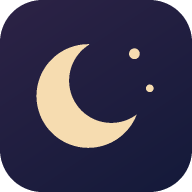
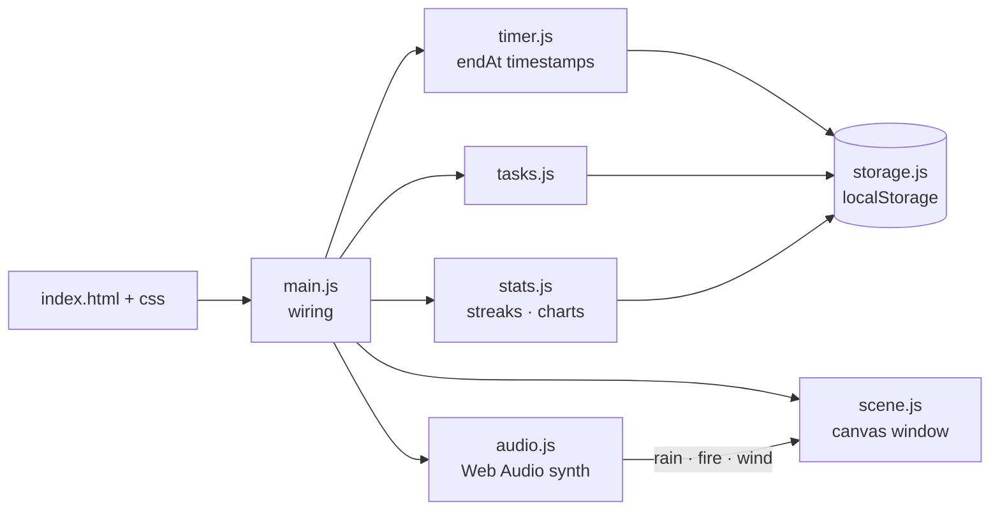

<div align="center">



# Hushroom

### Quiet, *on demand.*

**A calm focus room for students.** A Pomodoro timer, rain and fire made live in your browser, and a window that listens to your mix. No account, no backend, works offline.

<br />

[](https://urumb.github.io/hushroom/)


<sub>Built for the **BuildyourOwnWebsite Hackathon** by Roxten Studios</sub>

</div>

---

## The idea

Studying online usually means juggling a timer tab, a noise video full of ads and a to-do app. **Hushroom puts all three in one quiet place that feels nice to be in.**

You open a window onto a small, living scene. Switch on the rain and streaks run down the glass. Add the fireplace and the room glows warm. Press start and a timer ring begins to empty. When the chime sounds, your streak grows.

> Nothing is recorded. Nothing leaves your device. There are no audio files, no fonts to download and no analytics.

## What you get

| | Feature | Details |
| :-: | --- | --- |
| ⏱ | **Focus timer** | Focus, short break and long break. A smooth SVG ring, adjustable durations, auto-start, a soft chime and optional browser notifications. The countdown also shows in the tab title. |
| 🎚 | **Ambient mixer** | Rain, wind, fireplace, café murmur, brown noise and a lo-fi pad, each with its own switch and volume. Master volume, mute, and four presets: *Rainy library*, *Cosy cabin*, *Deep focus*, *Café study*. |
| 🪟 | **Living window** | A full-bleed canvas scene. The sky follows **Dawn · Day · Dusk · Night** (or **Auto** from your local time). Rain adds streaks and window droplets, fire adds a flickering glow, wind sways the trees and pushes the clouds. |
| ✅ | **Tasks** | Add, edit, complete, delete, drag to reorder (or use ↑ ↓). Make one task your *current focus*, and see sessions completed per task. |
| 📈 | **Insights** | Today, this week, current streak and all-time totals. A 7-day bar chart, a 12-week heatmap and badges. JSON export, import and reset. |
| 🌙 | **Focus mode** | One key hides everything except the scene, the timer and your current task. |
| 📲 | **Installable and offline** | A web manifest and a small service worker cache the whole site. |

## The look

The interface is calm and a little hand-made: a **paper-and-ink** look with warm cream, ink-brown and rust colours, serif headlines with an italic accent, a paper grain, thin ink borders and hard offset shadows. The timer is a tilted paper ticket with a spinning stamp and rolling digits. Below the full-bleed window hero the page scrolls through a marquee and four short sections: **Method**, **Sounds**, **Tasks** and **Insights**. It ends in a dark footer with a big faded wordmark.

The motion is hand-built too, with no animation library: split-word headlines that rise into place, hand-drawn underlines, a warm lamp and layered parallax that follow your cursor, a circular wipe when you change the sky or enter focus mode (in browsers that support the View Transitions API), buttons that lean toward the pointer, and scroll effects. All of it is turned down to simple fades when `prefers-reduced-motion` is on.

All four themes keep text at WCAG AA contrast, and every animation respects `prefers-reduced-motion`.

## Screenshots

> _Screenshots will be added to [`/screenshots`](screenshots/)._

| Night, with rain | Day | On a phone |
| :-: | :-: | :-: |
| `screenshots/night-rain.png` | `screenshots/day.png` | `screenshots/mobile.png` |

## Keyboard shortcuts

| Key | Action | | Key | Action |
| :-: | --- | --- | :-: | --- |
| <kbd>Space</kbd> | Start / pause | | <kbd>F</kbd> | Focus mode |
| <kbd>R</kbd> | Reset timer | | <kbd>T</kbd> | Cycle theme |
| <kbd>M</kbd> | Mute / unmute | | <kbd>?</kbd> | Show shortcuts |

## How it works



**Timer.** A running timer stores an absolute end time and recomputes `endAt - Date.now()` on every tick. It never counts ticks, so a throttled background tab can't make it drift. It re-checks the moment the tab becomes visible again.

**Sounds.** Every sound is built from the Web Audio API. White, pink and brown noise buffers are generated once and looped. Each channel is a small recipe:

| Sound | Recipe |
| --- | --- |
| Rain | high-passed noise wash, plus random short band-passed "drops" panned around the stereo field |
| Wind | band-passed noise with two slow LFOs: one sweeps the filter, one gusts the volume |
| Fireplace | brown-noise rumble, a quiet hiss, and random crackle bursts in small clusters |
| Café murmur | four band-passed noise layers whose loudness wanders at random, which the ear reads as distant chatter |
| Brown noise | integrated white noise, low-passed |
| Lo-fi pad | a slow four-chord loop of detuned triangle voices through a drifting low-pass, with the occasional soft bell |

A channel only builds its audio nodes while it is on, so idle sounds cost no CPU. Gain changes use `setTargetAtTime` to avoid clicks. Audio only starts after a user gesture, and saved sounds resume on your first tap or keypress.

**Scene.** One canvas. Theme colours are interpolated smoothly, the rain, fire and wind levels follow the mixer, the loop pauses when the tab is hidden, and with reduced motion it draws calm still frames.

**Data.** Everything lives in `localStorage` under `hushroom:` keys, always inside `try/catch`. Streaks use your local calendar day.

## Run it locally

No build step and no packages to install. Any static server works (ES modules need `http://`, not `file://`):

```bash
python -m http.server 8000
# open http://localhost:8000
```

## Project structure

```
index.html            page structure and dialogs
css/style.css         themes, layout, motion
js/main.js            bootstrap and wiring
js/timer.js           focus timer logic
js/audio.js           Web Audio sound engine
js/scene.js           animated window scene
js/tasks.js           task list
js/stats.js           stats, streaks, charts
js/storage.js         safe localStorage, export / import
sw.js                 offline cache
manifest.webmanifest  installable app
icons/                original logo and icons
tools/make_icons.py   generates the PNG icons (stdlib only)
```

## Accessibility

- Semantic landmarks and headings, a skip link, and visible focus outlines
- Everything works by keyboard; icon-only buttons carry ARIA labels
- Native range sliders and checkbox switches
- Text contrast meets WCAG AA in all four themes
- `prefers-reduced-motion` calms or removes animation
- The first-visit theme follows your OS: dark gives **Night**, otherwise **Auto**

## Hackathon

Built for the **BuildyourOwnWebsite Hackathon** (Roxten Studios, on Devpost) during the hackathon period, as a fresh build.

## Credits and AI disclosure

This project was built by **Noel Jacob Antony**. I used Claude Code (an AI coding assistant by Anthropic) to help write and review code, and I reviewed, tested and understand the code. No third-party frameworks or libraries are used at runtime. All sounds are generated in the browser with the Web Audio API, and all visuals are drawn with CSS, SVG and canvas. Icons and the logo are original (the PNG icons are generated by `tools/make_icons.py`, which uses only the Python standard library).

**Third-party code and assets:** none. The README badges are loaded from shields.io only when you view this page on GitHub. The site itself makes no external requests.

## Licence

MIT. See [LICENSE](LICENSE).

<div align="center"><sub>Made with care, for quiet people and loud deadlines.</sub></div>
